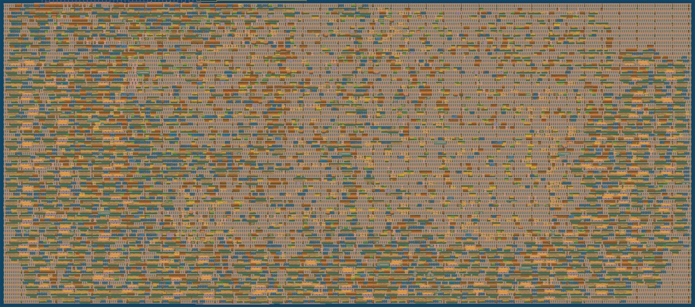
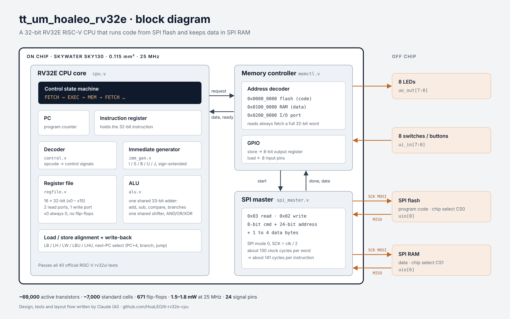
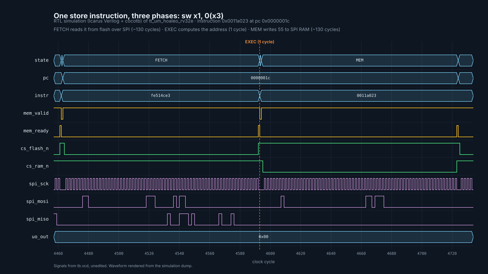
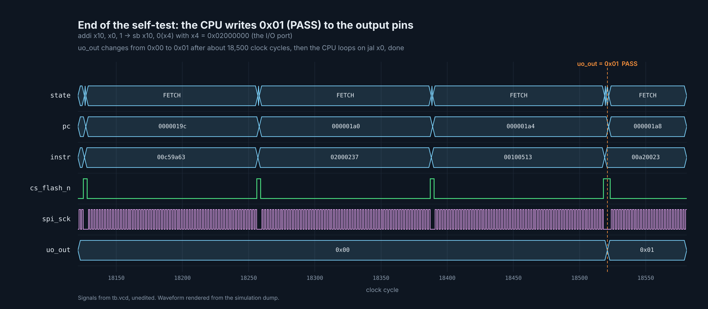
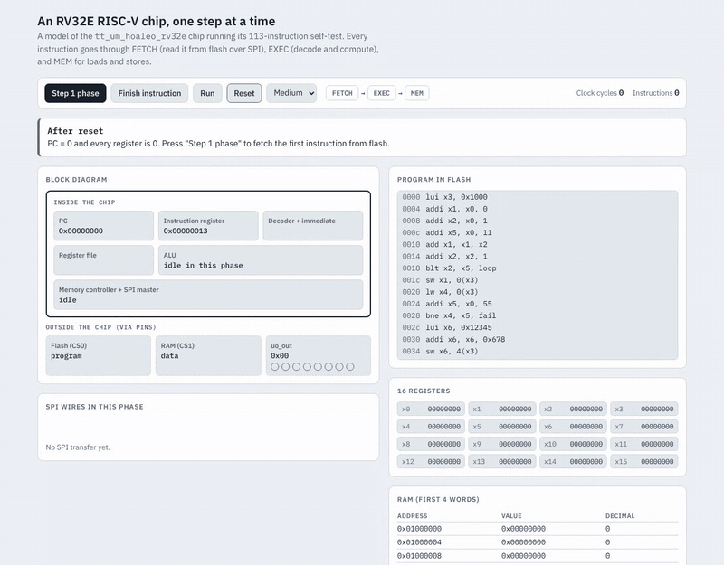
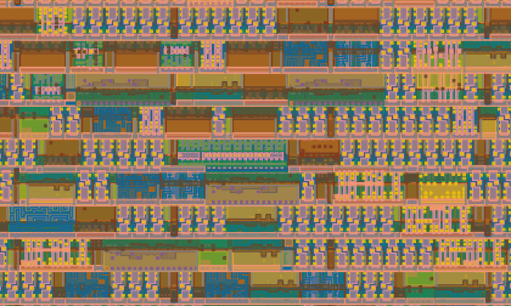

[](https://github.com/HoaLEO/tt-rv32e-cpu/actions/workflows/test.yaml)
[](https://github.com/HoaLEO/tt-rv32e-cpu/actions/workflows/gds.yaml)
[](https://github.com/HoaLEO/tt-rv32e-cpu/actions/workflows/fpga.yaml)
[](https://github.com/HoaLEO/tt-rv32e-cpu/actions/workflows/docs.yaml)


# RV32E RISC-V CPU with SPI memory

A small 32-bit RISC-V CPU (RV32E) for [Tiny Tapeout](https://tinytapeout.com), taken from RTL to a
signed-off chip layout on the SkyWater SKY130 130 nm process with open-source tools.
It runs code from an external SPI flash, keeps data in an external SPI RAM, and drives 8 output pins.



**[View the layout in 3D](https://gds-viewer.tinytapeout.com/?model=https://hoaleo.github.io/tt-rv32e-cpu/tinytapeout.oas&pdk=sky130A)**

> **Who did what.** This is a learning project. The design, the tests and the layout flow were written by
> [Claude](https://claude.ai) (an AI model by Anthropic). I, [HoaLEO](https://github.com/HoaLEO), followed every step,
> asked why at each one, and used the project to learn how a chip is designed, from transistors to layout.

## At a glance

| | |
|---|---|
| Instruction set | RV32E: the 37 base integer instructions with 16 registers. `FENCE`, `ECALL`, `EBREAK` act as no-ops |
| Microarchitecture | Multi-cycle: FETCH → EXEC → MEM |
| Memory | External SPI flash (code) and SPI RAM (data), 1-bit SPI, mode 0 |
| Process | SkyWater SKY130 (130 nm), `sky130_fd_sc_hd` standard cells |
| Area | 3x2 Tiny Tapeout tiles, about 0.115 mm², about 48 % utilisation |
| Clock | 25 MHz target. 9.5 ns setup slack in the slowest corner (100 °C, 1.6 V) |
| Size | About 7,000 standard cells, 671 flip-flops, about 69,000 active transistors |
| Power | About 1.5–1.8 mW at 25 MHz (OpenROAD estimate, typical corner) |
| Performance | About 141 clock cycles per instruction, about 0.18 MIPS at 25 MHz |
| Verification | Self-checking program + 40/40 official `rv32ui` riscv-tests (RTL), gate-level simulation |
| FPGA | Also builds for iCE40UP5K: 1,225 / 5,280 logic cells, about 16.9 MHz |

## Architecture



| Block | File | What it does |
|---|---|---|
| CPU core | [`src/cpu.v`](src/cpu.v) | PC, instruction register and a 3-state FSM around the RV32E datapath |
| Decoder | [`src/control.v`](src/control.v) | Opcode to control signals |
| Immediate generator | [`src/imm_gen.v`](src/imm_gen.v) | I / S / B / U / J immediates, sign-extended |
| Register file | [`src/regfile.v`](src/regfile.v) | 15 × 32-bit registers (x0 is hard-wired to 0), 2 read ports, 1 write port |
| ALU | [`src/alu.v`](src/alu.v) | One shared 33-bit adder for add, sub, compare and branches; one shared shifter |
| Memory controller | [`src/memctl.v`](src/memctl.v) | Address decoding, GPIO, request/ready handshake with the CPU |
| SPI master | [`src/spi_master.v`](src/spi_master.v) | READ `0x03` / WRITE `0x02`, 24-bit address, SCK = clk / 2 |
| Top level | [`src/project.v`](src/project.v) | `tt_um_hoaleo_rv32e`, wires everything to the Tiny Tapeout pins |

### How an instruction runs

1. **FETCH**: the CPU asks the memory controller for 4 bytes at the PC. The SPI master sends an 8-bit read command and a
   24-bit address, then clocks in 32 data bits. At 2 clock cycles per bit this takes about 130 cycles.
2. **EXEC** (1 cycle): decode, read registers, run the ALU, write the result and pick the next PC
   (PC + 4, branch target or jump target).
3. **MEM** (loads and stores only): another SPI transfer to read or write data, about 130 cycles.

Reads always fetch a full 32-bit word; the CPU picks out the byte or half-word it needs.

### Memory map

| Address | Device |
|---|---|
| `0x0000_0000` – `0x00FF_FFFF` | SPI flash on CS0 (code, read only) |
| `0x0100_0000` – `0x01FF_FFFF` | SPI RAM on CS1 (data) |
| `0x0200_0000` | I/O: a store writes the low byte to `uo_out`, a load returns `ui_in` |

### Pinout

| Pin | Function |
|---|---|
| `ui_in[7:0]` | General-purpose inputs, read at `0x0200_0000` |
| `uo_out[7:0]` | General-purpose outputs, written at `0x0200_0000` |
| `uio[0]` | Flash chip select (CS0, active low) |
| `uio[1]` | SPI MOSI |
| `uio[2]` | SPI MISO |
| `uio[3]` | SPI SCK |
| `uio[6]` | RAM chip select (CS1, active low) |

The uio pins follow the Tiny Tapeout QSPI Pmod layout, used here in 1-bit SPI mode.

## Verification

All tests run in GitHub Actions on every push ([`test` workflow](https://github.com/HoaLEO/tt-rv32e-cpu/actions/workflows/test.yaml)).
The testbench ([`test/tb.v`](test/tb.v)) connects the chip to behavioural models of an SPI flash and an SPI RAM
([`test/spi_mem_model.v`](test/spi_mem_model.v)); [cocotb](https://www.cocotb.org) drives clock and reset and checks the result.

| Test | What it checks |
|---|---|
| `test_program` | A 113-instruction self-checking program ([`test/make_hex.py`](test/make_hex.py)) that exercises every integer instruction and writes `0x01` (pass) or `0xFF` (fail) to `uo_out`. Checked against a Python reference model before it runs on the CPU |
| `test_riscv` | The 40 official `rv32ui` tests from [riscv-tests](https://github.com/riscv-software-src/riscv-tests), built for RV32E with clang and a minimal environment ([`test/riscv-tests/`](test/riscv-tests/)). `fence_i` and `ma_data` are skipped: the CPU has no writable instruction memory and no misaligned access |
| Gate-level | `test_program` again on the post-layout netlist, in the [`gds` workflow](https://github.com/HoaLEO/tt-rv32e-cpu/actions/workflows/gds.yaml) |

Run the tests locally (needs Icarus Verilog and Python):

```sh
cd test
pip install -r requirements.txt
make
```

### Waveforms

From the RTL simulation of the test program: one `sw` instruction going through FETCH, EXEC and MEM over SPI,



and the end of the self-test, when the CPU writes `0x01` (pass) to the output pins:



### Step-by-step demo

A model of the chip stepping through the test program (a JavaScript model that follows the RTL, not the Verilog itself):



## Physical design

The layout is built by the Tiny Tapeout flow ([LibreLane / OpenLane](https://github.com/librelane/librelane) on OpenROAD),
see [`src/config.json`](src/config.json) for the settings.

| Check | Result |
|---|---|
| Setup / hold timing, all corners | Pass at 25 MHz |
| DRC (Magic, KLayout) | Pass |
| LVS (Netgen) | Pass |
| Antenna | Pass |
| Tiny Tapeout precheck | Pass |
| Max slew / max capacitance | Warnings remain in the slow corners (see below) |



**[Open the 3D layout viewer](https://gds-viewer.tinytapeout.com/?model=https://hoaleo.github.io/tt-rv32e-cpu/tinytapeout.oas&pdk=sky130A)**: rotate and zoom the chip, turn each metal layer on and off, and click any cell to see its name.
The viewer files are published to GitHub Pages by the `gds` workflow on every push to `main`.

## Known limitations

- **Slow memory**: every instruction waits about 130 cycles for SPI, so the CPU runs at about 0.18 MIPS at 25 MHz.
  An instruction cache or QSPI (4-bit) would help the most.
- **No interrupts, timers, CSRs or hardware UART**, and no `M` extension (multiply/divide).
- **Max slew violations** remain on some high-fanout nets in the slow corners (485 in `max_ss_100C_1v60`,
  worst 1.50 ns against a 0.75 ns limit). They do not break timing, but should be fixed before a real tape-out.
- **Not fabricated.** The design has only been simulated and laid out.

## Repository layout

```
src/                 Verilog sources and OpenLane config
test/                cocotb testbench, SPI memory models, self-checking program
test/riscv-tests/    Official rv32ui tests built for this chip, and how to rebuild them
docs/info.md         Datasheet page for Tiny Tapeout
docs/images/         Images used in this README
info.yaml            Tiny Tapeout project description
```

## Credits and licence

- Built on the [Tiny Tapeout](https://tinytapeout.com) Verilog template and flow.
- Official tests from [riscv-software-src/riscv-tests](https://github.com/riscv-software-src/riscv-tests) (BSD 3-Clause).
- Design, tests and flow written by Claude (Anthropic), with HoaLEO.
- Licensed under the [Apache License 2.0](LICENSE).
